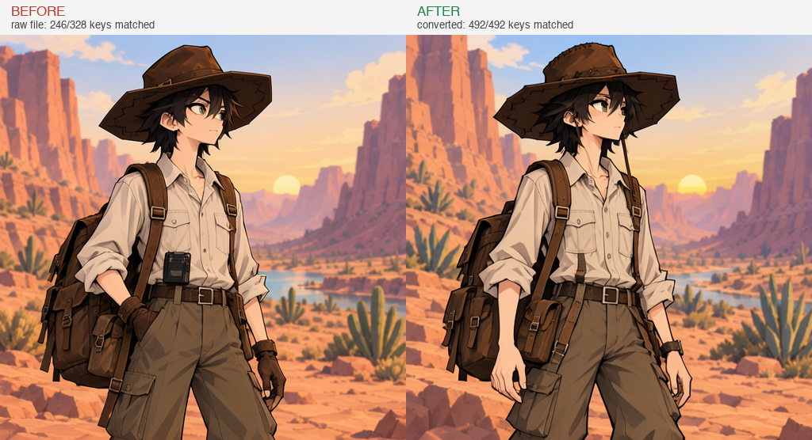

# moss-lora-convert

[](LICENSE)
[](pyproject.toml)
[](#installation)

**English** · [简体中文](README.zh-CN.md)

Convert MOSS-Image LoRAs between **ComfyUI / kohya / peft** and **mflux**.

Most MOSS LoRAs downloaded from the community fail with `No LoRA layers were applied` when fed to mflux. The file is not broken — the key names and tensor layouts differ. This tool does two things:

1. **Rename** — `lora_unet_layers_0_proj_q` / `transformer.layers.0.proj.q` → `diffusion_model.layers.0.proj.q`
2. **Reshape** — split fused QKV into q/k/v, split fused `ffn_up_gate` into up/gate (and merge back)

Conversion is **lossless** (round-trip is element-wise identical, see [self-test](#self-test)) and never touches weight values — only names and slices.



*Same prompt, same seed, same LoRA, same scale 0.8. **Left:** the raw ComfyUI-style file, where mflux matches only 246/328 keys and the QKV layers are silently dropped. **Right:** after `moss-lora-convert --to mflux`, 492/492 keys matched — the attention layers now actually contribute to the style.*

---

## Why this is needed

The MOSS-Image DiT has six projections per block: `q, k, v, o, ffn_up_gate, ffn_down`. Different ecosystems store them **differently**:

| | q / k / v | FFN | Key style |
|---|---|---|---|
| **mflux** / DiffSynth | separate | `ffn_up_gate` fused (2×ffn_dim, up first then gate) | `diffusion_model.layers.N.proj.X.lora_down/up.weight` |
| **kohya** (common in ComfyUI) | often fused into `qkv` | `ffn_gate` + `ffn_up` separate | `lora_unet_layers_N_proj_X.lora_down/up.weight` |
| **peft** (ai-toolkit) | either | depends on the trainer | `transformer.layers.N.proj.X.lora_A/B.weight` |

So renaming alone is not enough — **fused tensors must be sliced at the right ratio**:

```
qkv.lora_up         [9216, r]  ->  q [3072] + k [3072] + v [3072]
ffn_up_gate.lora_up [16384, r] ->  up [8192] + gate [8192]   # up comes first
```

Get the order or ratio wrong and loading still succeeds — but the style **silently degrades or breaks**.

---

## Installation

```bash
pip install -e .            # CLI + library only
pip install -e ".[mlx]"     # recommended if you have MLX (handles bf16 directly)
```

No torch required. The tensor backend prefers MLX and falls back to `safetensors.numpy` (fine for fp16/fp32; bf16 needs MLX).

---

## Usage

### CLI

```bash
# what format is this file? (writes nothing)
moss-lora-convert my_lora.safetensors --inspect

# convert to something mflux can load
moss-lora-convert my_lora.safetensors --to mflux

# convert back to ComfyUI / kohya
moss-lora-convert my_lora.mflux.safetensors --to comfyui -o my_lora.comfy.safetensors

# explicit output
moss-lora-convert in.safetensors --to peft -o out.safetensors
```

`--inspect` prints something like:

```
File: american_comic.safetensors
Keys: 328
Style: peft (lora_A/B, prefix 'diffusion_model.')
Layers: 41
Projections: ['ffn_down', 'ffn_gate', 'ffn_up', 'k', 'o', 'q', 'v']
Alpha: 0
```

### ComfyUI nodes

Drop this directory into `ComfyUI/custom_nodes/` (or symlink it) and restart. Two nodes appear under **MOSS/LoRA**:

- **MOSS LoRA Convert** — pick a file from `models/loras`, choose a target format, get the converted absolute path
- **MOSS LoRA Inspect** — detection only, returns a text report

### Python

```python
from mosslora import convert

stats = convert("my_lora.safetensors", "my_lora.mflux.safetensors", to="mflux")
print(stats)   # {'src_format': 'kohya', 'src_keys': 756, 'dst_keys': 756, 'layers': 42, ...}
```

---

## Support matrix

| input → output | mflux | comfyui | kohya | peft |
|---|---|---|---|---|
| **mflux** | — | ✅ lossless | ✅ lossless | ✅ lossless |
| **kohya** | ✅ lossless | ✅ lossless | — | ✅ lossless |
| **peft** | ✅ lossless | ✅ lossless | ✅ lossless | — |
| **fused qkv** | ✅ split | ✅ kept fused | ✅ split | ✅ split |
| **fused ffn_up_gate** | ✅ kept | ✅ split | ✅ split | ✅ split |

"Lossless" means round-trip is **element-wise identical** — see the self-test below.

**One detail about qkv fusion**: when converting mflux → comfyui, a layer is fused only if its q/k/v `lora_down` tensors are **identical**. Otherwise the projections stay separate (ComfyUI accepts `proj_q`/`proj_k`/`proj_v` too) with a warning — fusing would discard two of the three down tensors, which is lossy.

---

## Self-test

```bash
# synthetic check — no weights needed
python acceptance.py

# full check with real community LoRAs
python acceptance.py \
    --akk path/to/akk_4step_lora.safetensors \
    --animated path/to/animated_moss.safetensors \
    --comic path/to/american_comic.safetensors
```

Results on three real community LoRAs (2026-10):

| file | original | round-trip | result |
|---|---|---|---|
| akhaliq 4-step distill | mflux, 756 keys (alpha + fused ffn) | mflux→kohya→mflux | **756 tensors element-wise equal** |
| axiomofmind animated | mflux, 504 keys (no alpha) | mflux→kohya→comfyui→mflux | **504 tensors element-wise equal** |
| gordonz American comic | peft + fused qkv, 328 keys | → mflux 492 keys | 492/492 matched by the mflux loader (raw file: 246/328) |

The third row is the point: **the raw file loads only 246/328 keys** (82 qkv keys dropped, the attention layers contribute nothing), while the converted one loads 492/492.

---

## Limitations

- **DiT LoRAs for MOSS-Image only.** Text-encoder LoRAs and other low-rank formats (LoKr/LoHa) are out of scope.
- **No numerical repair.** If the LoRA itself is broken, conversion will not fix it.
- **bf16 requires MLX.** The pure-numpy backend cannot read bf16 safetensors.
- Layer indices are **positional** — no cross-version remapping. If the MOSS block structure changes, indices will not line up.

---

## License

Apache-2.0. No model weights are included.

(MOSS-Image itself follows OpenMOSS's license, unrelated to this tool.)
